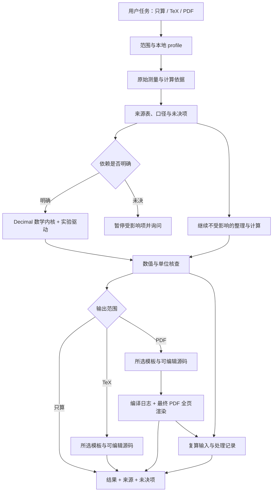

# 架构与验证边界

本 skill 将数据来源、数学运算和报告版式分开。当前任务决定读取哪些参考文件；只算任务不加载报告工具链。公开包不含私人课程路径、学生信息或往届报告，课程偏好来自用户工作区的适用 `AGENTS.md`/课程卡或 skill `.local/profile.md`，未选用时使用 generic 行为。

| 层 | 负责 | 不替代 |
|---|---|---|
| [入口](../SKILL.md) | 范围、必要约束、按需读取 | 具体课程事实 |
| [来源与裁决](../references/provenance.md) | 输入角色、冲突、筛选、定位 | 用户确认及原始材料 |
| [计算契约](../references/calculation-contract.md) | 数值 API、边界、统计解释 | 仪器规格与课程模型 |
| `scripts/labmath/` | 可复算数值操作与兼容算法 | 单位系统、OCR、相关性判断 |
| [版式与 QA](../references/report-layout.md) | 可编辑报告、编译、全页目视 | 数据真实性和教师认可 |
| [处理记录](../references/audit-record.md) | 决策、输入、产物与验证留痕 | 共享 skill 的自动更新 |

数值内核分模块，不代表其默认参数全都具有通用统计含义。`measurement` 中的两种历史结果算法及 `bridge` 中的仪器预设保留兼容性，使用前仍需核对本次材料。计算契约区分误差限、标准不确定度和扩展不确定度，并提供 NIST 原始资料链接。

## 三层验证

1. **自动测试**：数学恒等关系、边界、CLI/Python 一致性和兼容基准。它们验证软件行为，不证明原始输入识别或课程口径正确。
2. **情景评估**：[evals/evals.json](../evals/evals.json) 提供三个构造用户任务。执行者仅接收其中的 `prompt` 及 skill，评分者再依据 `assertions` 检查真实输出和工具记录。不要将评分断言或预期数值发给执行者。
3. **产物验收**：实际实验的全量复算、来源回查，以及 PDF 最终版全页渲染；只有要求 PDF 时才引入这条验收链。

场景评估覆盖“资料充分就计算”“系数冲突只暂停依赖项”“奇数逐差点保持完整并尊重只算范围”。这些是人工/代理行为场景，不是已经运行的测试结果；仓库记录应区分定义了场景与真正完成了独立评估。
